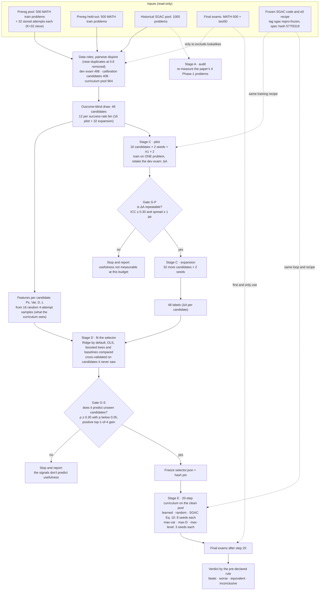
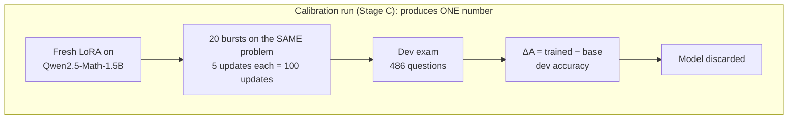
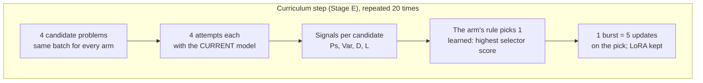

# SGAC calibration track: the whole picture

**The question.** Can we build a *better* SGAC selector by measuring how much each training problem actually helps,
and does that selector beat Random and the original SGAC (Eq. 10) inside the unchanged 20-step curriculum?

The rules are frozen in [`paper/sgac_calib_protocol.md`](../../paper/sgac_calib_protocol.md) (tag
`sgac-calib-protocol-v1`). This page is a plain-language map of that protocol; where they differ, the protocol wins.

> **Update 2026-10-15: the pilot failed gate G-P.** The reasons are in protocol §13, amendment A1, and in
> [`reports/sgac_calib/REPORT.md`](../../reports/sgac_calib/REPORT.md).
>
> - At SGAC's training dose, every problem perturbs the same ~76 fragile dev questions. Two seeds of one problem agree
>   no more than runs on different problems, so there is no problem-specific usefulness to learn.
> - The equation fitted on those labels (E1) has no predictive validity.
>
> The queue continues as follows:
>
> 1. The protocol's pre-declared rung C2 (4× training).
> 2. An **exploratory** calibration in the one-shot regime whose positive control is known to work: the prereg
>    Study-1 trainer, groups of 64.
> 3. A selector fitted on those labels and tested end to end in the curriculum below.
>
> One command runs it all:
> `STAGES=os_pilot,os_expansion,os_selector,os_curriculum,c2 scripts/local/sgac_calib.sh`.

## 1. The pipeline

Three things to notice:
- **Two gates can stop the track early** (G-P, G-S). Stopping is a result, not a failure: it says what cannot be learned
  at this training budget, and it saves the GPU time of the later stages.
- **The final exams are touched only at the very end.** Labels come from a separate 486-question dev exam, so the
  selector is never tuned on MATH-500 or test50.
- **Nothing historical changes.** Every run uses the frozen SGAC loop and the e0 recipe (the code refuses to run if the
  spec hash is not `577f3319`); only the results folder is different.

## 2. Two kinds of training run

Both use exactly 100 updates in total. A calibration run spends them all on one problem (so its effect is big enough
to measure); a curriculum spends 5 on each of 20 picked problems. Whether "useful alone" predicts "useful inside the
curriculum" is precisely what Stage E tests.

## 3. The selector

Four signals per candidate, measured from 4 attempts by the current model:

| Signal | Meaning |
|---|---|
| **Ps** | share of the 4 attempts that are correct |
| **Var** | variance of the reward (correct + 0.5 × has a boxed answer) |
| **D** | number of distinct answers / 4 (disagreement) |
| **L** | MATH difficulty level, 1–5 |

The default model is a ridge regression:

&nbsp;&nbsp;&nbsp;&nbsp;`score = b0 + b1·Ps + b2·Var + b3·D + b4·L`, trained to predict ΔA.

- No coefficient has a required sign; any may come out near zero.
- It is compared with OLS, a small boosted-tree model, and baselines: difficulty only, success rate only, the
  original Eq. 10, the single-signal rules and random. A nonlinear model replaces Ridge only if clearly better.
- It must predict candidates it never saw (gate G-S) before it is ever deployed.
- Deployed rule: in each batch of 4, train on the candidate with the highest score.

For contrast, the original Eq. 10 (`0.0050·Ps + 0.1832·Var − 0.0751·D + 0.2188·L`) was fit on 20 problems with its
labels shifted by one feature, and at K=4 it always picks a maximum-level problem.

## 4. What each outcome would let us say

| G-P | G-S | Final curriculum | Claim |
|---|---|---|---|
| fail | — | not run | One problem's usefulness is not measurable at this budget. |
| pass | fail | not run | Problems differ in usefulness, but Ps/Var/D/L don't predict it. |
| pass | pass | beats Random **and** SGAC | The calibrated selector improves the curriculum (with its cost reported). |
| pass | pass | equivalent / inconclusive | It predicts usefulness, but no curriculum gain above ~2 pp. |

"Beats" needs a Holm-corrected p < 0.05, a gain of at least 1 pp, and the same direction in at least 7 of 8 seeds.

## 5. Stages, commands and cost

All GPU work runs on the workstation, one stage at a time: `STAGES=<stage> scripts/local/sgac_calib.sh`.
A failed gate stops the queue (exit code 3); re-running the same command resumes.

| Stage | What it does | GPU-h | Gate at the end |
|---|---|---|---|
| `t0` | spec, manifest and feature checks; GPU smoke; timing projection | ~1 | — |
| `audit` | Stage A: the paper's 4 Phase-1 problems, E0 and historical settings | ~1.5–3 | — |
| `pilot` | base dev exam ×2, 16 candidates × 2 seeds, π1 × 2 | ~27 | G-P |
| `expansion` | 32 more candidates × 2 seeds, labels | ~50 | — |
| `selector` | fit, cross-validate, permutation test, freeze (CPU) | 0 | G-S |
| `curriculum` | base exams, 6 arms (learned/random/SGAC × 8 seeds, heuristics × 3), analysis | ~44 | verdict |
| `tm` | exploratory: Random given the selector arms' extra GPU time | ~2–5 | — |

Costs use the T0 measurement (0.78 h per calibration run) and the reproduction's 1.3 h per curriculum run.

## 6. Where things are

| | Location |
|---|---|
| Protocol (frozen) | `paper/sgac_calib_protocol.md` |
| Config | `configs/sgac_calib/calib.yaml` |
| Committed manifests | `configs/sgac_calib/manifests/`: data roles, the 48-candidate draw, features, seed count, schedules (seeds 42–49); later the frozen selector |
| Code | `rlvr_v2/sgac_calib/` (this folder): `manifests`, `features`, `calib` (runs, labels, G-P), `selector` (fit, G-S, freeze), `curriculum` (learned arm), `crossed` + `analysis` (final statistics), `cli`, `jobs` |
| Launcher | `scripts/local/sgac_calib.sh` |
| Tests | `tests/test_sgac_calib_*.py` |
| Results (workstation, not in git) | `results_sgac_calib/{t0,audit,calib,selector,curriculum}/` |
| Historical reproduction (frozen) | `rlvr_v2/sgac/`, `report.md`, `paper/sgac_repro_freeze.md`, tag `sgac-repro-frozen` |
